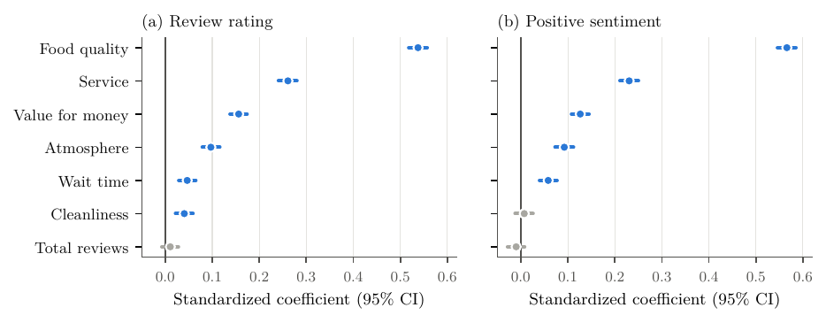

# Is Good Food Really Enough to Get 5 Stars on Google Maps?

**What drives customer satisfaction in Parisian restaurants**

Nathan Tessot · CPES Data Science & Cultural Sciences, Université PSL · April 2026

📄 **[Read the paper (PDF)](report/Good_Food_5_Stars_Google_Maps_Tessot.pdf)** · 📓 [Notebook](google_maps_reviews.ipynb)

---

## Question

Which aspects of a dining experience are most strongly associated with a good rating
and a positive sentiment on Google Maps?

## Data and method

- **Collection**: Parisian restaurants and their reviews retrieved with the Google Maps
  Places API (March 2026), sampled so that each rating level keeps its share in the API
  results: **5,000 reviews from about 3,800 restaurants**.
- **LLM annotation**: each review was scored by Qwen2.5 from −2 to +2 (0 = not mentioned)
  on six criteria (food quality, value for money, service, wait time, atmosphere,
  cleanliness), plus a binary overall sentiment. The full annotation prompt is in the
  appendix of the paper and in [`report/prompt.txt`](report/prompt.txt).
- **Models**: two multiple linear regressions (OLS) on standardized variables, explaining
  the star rating and the positive sentiment from the six criteria and the restaurant's
  total number of reviews.

## Results



| Predictor | Review rating (β) | Positive sentiment (β) |
|-----------|------------------:|-----------------------:|
| Food quality | **0.538** | **0.566** |
| Service | 0.261 | 0.231 |
| Value for money | 0.156 | 0.127 |
| Atmosphere | 0.097 | 0.093 |
| Wait time | 0.047 | 0.058 |
| Cleanliness | 0.041 | 0.007 (n.s.) |
| Total reviews | 0.011 (n.s.) | −0.010 (n.s.) |
| R² | 0.60 | 0.58 |

- **Food quality is by far the main driver**, with an effect about twice that of service.
- **Service comes second**, followed by value for money and atmosphere.
- **Popularity has no effect**: a restaurant's number of reviews does not predict individual
  ratings.
- **Cleanliness** slightly affects the rating but not the overall sentiment.

## Repository structure

```
├── google_maps_reviews.ipynb   Analysis: DAG, descriptive statistics, regressions, forest plots
├── data/
│   └── reviews_annotated.csv   LLM scores, rating, sentiment and popularity for the 5,000 reviews
├── report/
│   ├── Good_Food_5_Stars_Google_Maps_Tessot.pdf
│   ├── main.tex, prompt.txt    LaTeX source of the paper
│   ├── figures/
│   └── scripts/make_fig2.py    Regenerates the descriptive figure (run from report/scripts)
└── requirements.txt
```

The published dataset contains only the variables used in the analysis. Review texts,
restaurant names and locations are not redistributed, in line with the Google Maps
Platform terms of service.

## How to run

```bash
pip install -r requirements.txt
jupyter notebook google_maps_reviews.ipynb
```

## References

- Li, Z., & Hecht, B. (2020). 3 stars on Yelp, 4 stars on Google Maps: A cross-platform
  examination of restaurant ratings. *Proc. ACM Hum.-Comput. Interact.*, 4(CSCW2), 1–24.
- Luca, M. (2016). Reviews, reputation, and revenue: The case of Yelp.com. *Harvard Business
  School Working Paper* 12-016.
- Zeithaml, V. A. (1988). Consumer perceptions of price, quality, and value. *Journal of
  Marketing*, 52(3), 2–22.
